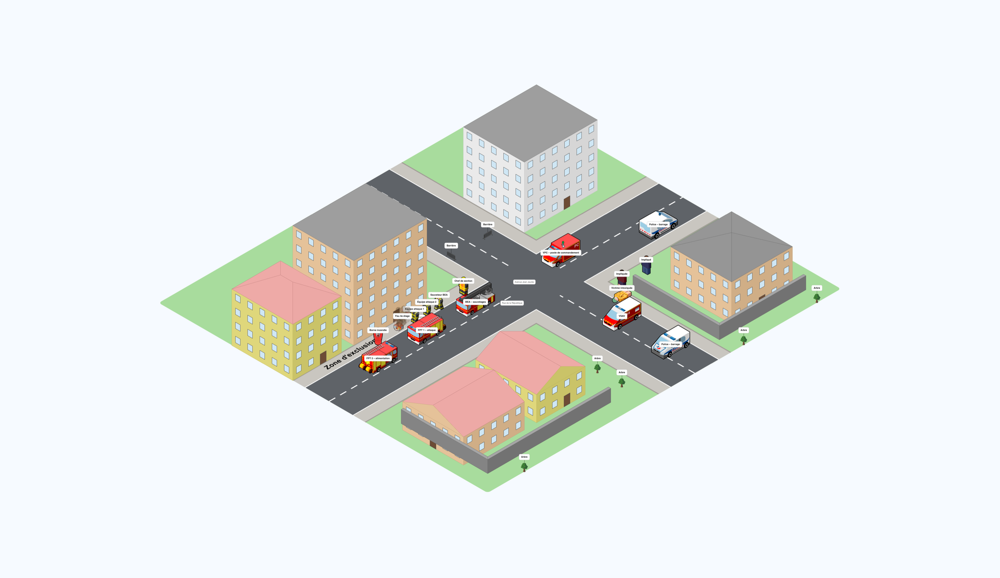
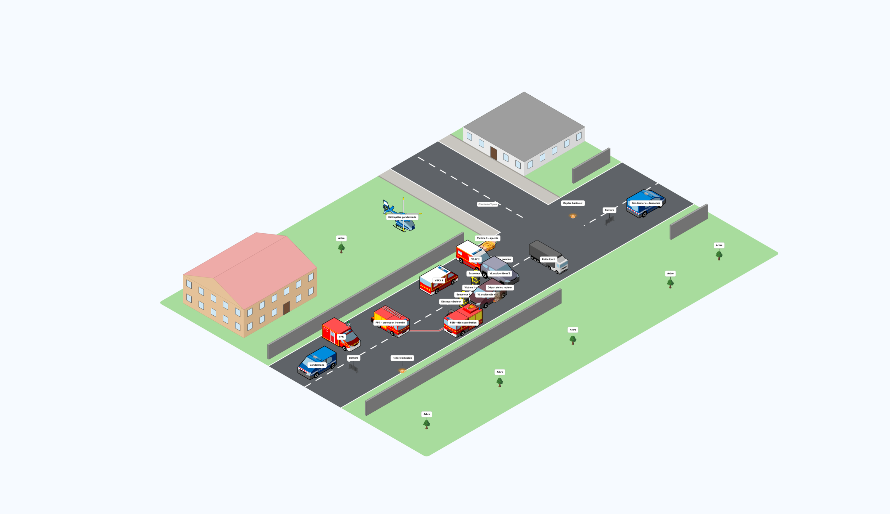
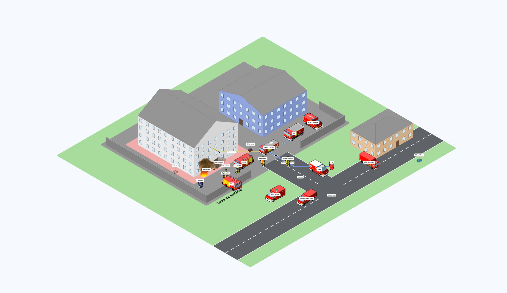
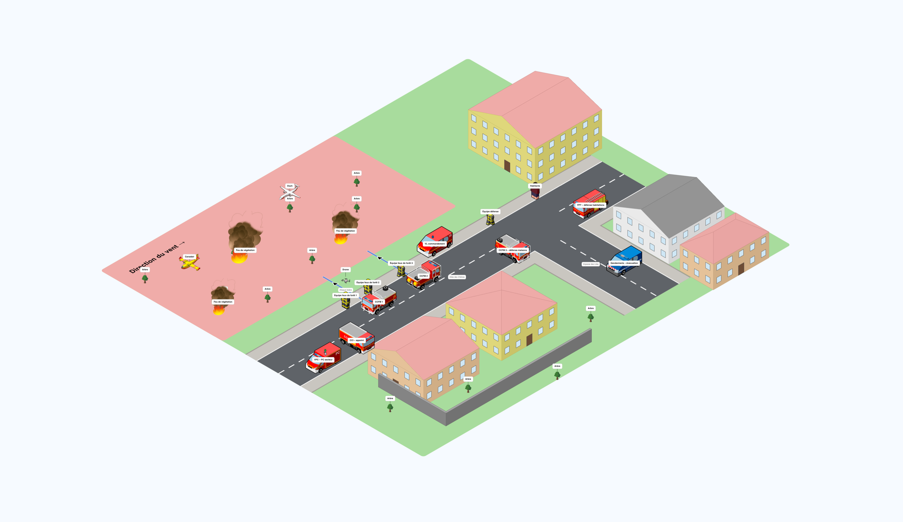
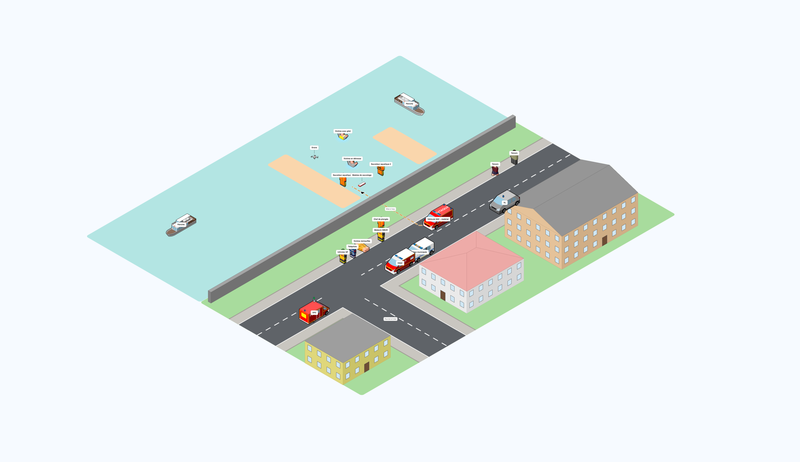
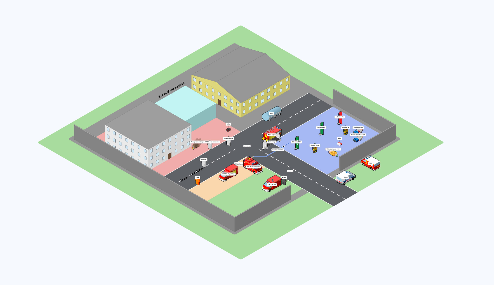

# Scènes d'exemple – interventions de sapeurs-pompiers

*Example scenes – firefighting operations (English summary at the bottom).*

Six scènes d'exemple prêtes à l'emploi, construites avec la bibliothèque d'icônes SDMIS et les éléments de décor d'Isoflam : **routes** (largeur, trottoirs, nom de rue), **murs** (hauteur, épaisseur, angles), **volumes** et **bâtiments** (étages, toits, fenêtres, porte). Chaque scène est fournie avec son fichier JSON et son rendu, obtenu avec l'option **Exporter en image** d'Isoflam.

| # | Scène | Éléments de décor mis en avant | Rendu | JSON |
|---|-------|-------------------------------|-------|------|
| 1 | **Feu d'immeuble au carrefour** : attaque, BEA en façade, périmètre au carrefour | Deux routes à trottoirs qui se croisent, immeuble R+5 à toit plat, maisons à toits à deux et quatre pans, murets de jardin |  | [JSON](01_feu_immeuble_carrefour.json) |
| 2 | **Accident routier sur la départementale** : désincarcération, balisage, SUAP, hélicoptère | Route large sans trottoir, carrefour en T, glissières de sécurité (murs bas), station-service, maison |  | [JSON](02_accident_routier_departementale.json) |
| 3 | **Feu d'entrepôt en zone industrielle** : mousse, lances canon, bâche, drone | Entrepôts à grands toits à deux pans, mur de clôture avec entrée, voie d'accès et rue de desserte |  | [JSON](03_feu_entrepot_zone_industrielle.json) |
| 4 | **Feu de forêt en lisière de lotissement** : CCFM, défense des habitations, appui aérien | Maisons de tailles et de toits variés, murets de jardin, allée et impasse avec trottoirs |  | [JSON](04_feu_foret_lotissement.json) |
| 5 | **Sauvetage aquatique au quai** : chute à l'eau, embarcation, SMUR, réchauffement | Mur de quai, route de quai avec trottoirs, capitainerie et entrepôt portuaire |  | [JSON](05_sauvetage_aquatique_quai.json) |
| 6 | **Intervention NRBC sur site industriel** : décontamination, poste médical avancé | Enceinte murée à une entrée, voies internes, usine, hangar, cuve (volume) |  | [JSON](06_nrbc_site_industriel.json) |

## Ouvrir une scène

1. Ouvrir [Isoflam](https://isaratech.github.io/isoflam/).
2. Menu principal → **Ouvrir un JSON**, puis choisir l'un des fichiers `.json` de ce dossier.
3. Modifier la scène à volonté, puis **Exporter en JSON** ou **Exporter en image**.

Pour reproduire les rendus de ce dossier : **Exporter en image**, décocher **Vue actuelle** (la scène entière est exportée à pleine taille).

## Format des fichiers

Les JSON de ce dossier sont volontairement **allégés** : ils référencent les icônes SDMIS par leur identifiant (`sdmis_…`) et n'embarquent pas les icônes elles-mêmes, contrairement à l'export natif de l'application (plusieurs Mo). Le champ `icons` est optionnel : Isoflam utilise alors sa bibliothèque intégrée.

Structure d'un fichier (`views[0]`) :

- `items` : position de chaque élément (`tile: {x, y}`, `scaleFactor` et `layer` optionnels) ; les noms et icônes sont dans `items` à la racine ;
- `rectangles` : sols colorés ; avec `height` (en tuiles) le rectangle devient un **volume**, avec `building` (`roof` : `FLAT`, `GABLE`, `HIP`, `roofHeight`, `roofColor`, `windows`, `door`, `doorFacade`) un **bâtiment** ;
- `connectors` : liaisons entre éléments, **murs** (`height` > 0, l'épaisseur est `width`) et **routes** (`variant: "ROAD"`, `roadWidth`, `sidewalks`, le nom de rue est la `description`) ;
- `textBoxes` : annotations de zones.

## Règles de superposition

Isoflam dessine les éléments par couches : sols, routes, volumes, murs et liaisons, textes, puis **toutes les icônes au-dessus**. Pour un rendu cohérent, ces scènes respectent les règles suivantes :

- **Volumes** : le premier rectangle du tableau est dessiné au-dessus des suivants. Les bâtiments sont donc listés **du plus proche au plus éloigné** (le plus proche du bas de l'écran, c'est-à-dire aux coordonnées les plus faibles), pour qu'un bâtiment passe devant celui qui est derrière.
- **Murs** : ils sont tous dessinés au-dessus des volumes et, entre eux, dans l'ordre du tableau (le premier dessus). Ils sont placés **devant** les bâtiments : les clôtures sont des « L » ou des « U » côté avant, jamais derrière un bâtiment qu'elles masqueraient à tort.
- **Icônes et textes** : toujours au-dessus des volumes et des murs. Un engin, une personne ou une étiquette n'est donc jamais placé **derrière** un bâtiment ou un mur (ils paraîtraient posés dessus) : ils sont devant la façade ou sur un sol visible.
- **Calques** : pour forcer l'ordre d'une icône (flammes sur une façade, aéronefs), utiliser son `layer`.

## English summary

Six ready-to-use example scenes (apartment fire at a crossroads, road accident, warehouse fire, wildfire at a housing estate, water rescue at a quay, CBRN decontamination line) that showcase roads (width, sidewalks, street name), walls, volumes and buildings (floors, roofs, windows, door), rendered with Isoflam's own **Export as image**. Open them via **Main menu → Open** and choose a `.json` file from this folder. The files are lightweight: icons are referenced by id and not embedded. Layering rules used: buildings are listed nearest first, walls stand in front of buildings, and icons are never placed behind a building or a wall.
